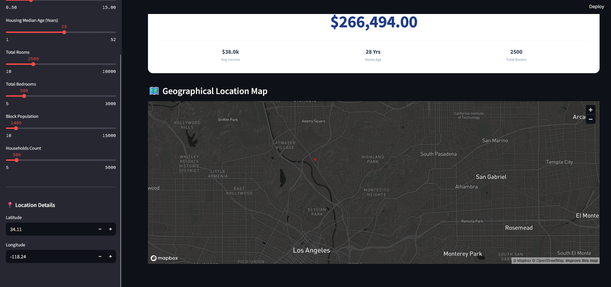

# 🏠 California Home Valuation Engine

An interactive, premium-grade real estate valuation platform built using Streamlit and Scikit-Learn. This application leverages a trained Random Forest Regressor model to estimate property values across California block groups based on various geographic and socio-demographic features.

---

## 🚀 Project Overview

This project provides an easy-to-use graphical interface where clients and real estate agents can input property attributes and get an instant, machine-learning-powered pricing prediction. 


### Key Features
* **Sleek, Minimalist Interface**: Clean design emphasizing results without overwhelming users with complex technical metrics.
* **Real-time Map Integration**: Automatically pins and visualizes selected geographical coordinates on an interactive map.
* **Instant Calculations**: Predicts the property value instantly as sidebar variables are updated.




---

## 🛠️ Model Performance (Backend Documentation)

While the frontend UI is designed to remain simple for the client, the backend architecture features a robust predictive model trained on over 17,000 California residential records:
* **Algorithm**: Random Forest Regressor
* **Validation R² Score**: `82.28%` of variance explained
* **Validation RMSE**: `$49,414.55`

---

## 💻 Local Installation & Setup

To host this application locally on your computer, follow these quick steps:

### 1. Clone or Download Files
Ensure you have downloaded the following files into a single directory on your machine:
* `app.py` (The Streamlit app file)
* `california_housing_rf.joblib` (The serialized model file)

> ⚠️ **Note on Large Model Files:** If you are cloning this repository from GitHub and do not see the `.joblib` model file because of GitHub size limits, you can easily train and generate the model locally by running your notebook's training cells to write the file to your computer.

### 2. Install Required Dependencies
Open your Terminal or Command Prompt in the project folder and run:
```bash
pip install streamlit joblib numpy pandas scikit-learn
```

### 3. Run the Web Server Locally
Execute the application using the Streamlit CLI:
```bash
streamlit run app.py
```
Your browser will automatically open the application at `http://localhost:8501`.

---

## 👤 Author & Contact Info

Feel free to reach out for collaborations, questions, or feedback!

[](https://www.linkedin.com/in/abdulmalik-tajudeen-86602b38b/)  
[](mailto:abdulmaliktajudeen5@gmail.com)  
[](https://abdulmalik-ade.github.io)
